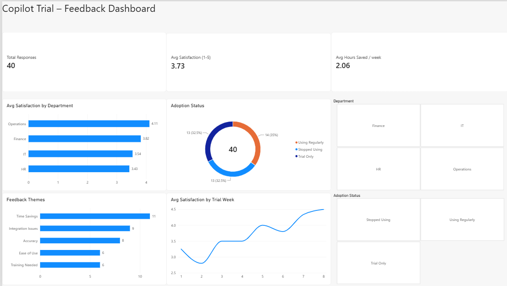

# Copilot Trial Feedback & Metrics Dashboard

A project that models how a generative AI Copilot adoption trial could be evaluated: collecting user feedback, tracking adoption over an 8-week trial, and turning raw responses into metrics a project team could act on.

It was built first in **Microsoft Excel**, then rebuilt as an interactive **Power BI** dashboard.

## Why this project

Built around these responsibilities from a real job posting:

> "Collecting and analyzing feedback data to derive useful metrics"

> "Helping develop procedures to improve evaluation processes for activities such as our Copilot trials"

## Note on the data

All 40 responses are **randomly generated for demonstration**. They don't represent a real trial or real people. The goal is to show the analysis structure, formulas and dashboard working correctly on realistic-looking data.

## Repository contents

| File | Description |
|---|---|
| `copilot_trial_feedback_dashboard.xlsx` | Excel version: raw data, formula-driven dashboard, and an in-workbook README |
| `Copilot_Trial_Dashboard.pbix` | Power BI version of the dashboard (open with Power BI Desktop) |
| `dashboard.png` | Screenshot of the Power BI dashboard |

## Part 1: Excel dashboard

- **Raw Data:** 40 simulated feedback responses across 4 departments over an 8-week trial: satisfaction score, time saved, adoption status, feedback theme and a comment. Modeled on what a Microsoft Forms or survey export would look like.
- **Dashboard:** live formulas (`AVERAGEIF`, `COUNTIF`, `COUNTIFS`) that calculate:
  - overall response count, average satisfaction, average time saved, and % of users "Using Regularly"
  - satisfaction and time saved by department
  - week-by-week satisfaction trend and adoption rate
  - frequency of feedback themes (Ease of Use, Time Savings, Accuracy, Training Needed, Integration Issues)
  - three charts visualizing the results
- **README (in-workbook):** explains the data and how each formula maps to a real evaluation workflow.

Everything recalculates automatically: replace the Raw Data rows with a real feedback export and the dashboard updates.

## Part 2: Power BI dashboard

I rebuilt the dashboard in Power BI, starting from the raw data only, so that Power BI does all the calculations.

**Data preparation (Power Query)**
- Imported only the Raw Data sheet, not the pre-calculated Excel summaries
- Converted `ResponseDate` from Excel serial numbers (e.g. 46213) into a proper date type
- Checked data types, trimmed text columns, and removed duplicate and blank rows

**Report**
- **KPI cards:** Total Responses (Count), Avg Satisfaction (Average), Avg Hours Saved per Week (Average). Each measure uses the right aggregation: IDs are counted, not summed.
- **Avg Satisfaction by Department:** bar chart, sorted highest to lowest
- **Adoption Status:** donut chart (Using Regularly / Trial Only / Stopped Using)
- **Feedback Themes:** bar chart, sorted by frequency
- **Avg Satisfaction by Trial Week:** line chart showing the trend over time
- **Slicers:** filter the whole page by Department and Adoption Status. Clicking any chart also cross-filters the others.

**Testing**
While testing the report, I noticed the trend chart was sorted by satisfaction value instead of by week, which made satisfaction look like it was falling. I changed it to sort by week so the chart tells the correct story.

## Findings (from the simulated data)

- **Adoption is low:** only 35% of users were using Copilot regularly, and 32.5% had stopped.
- **Integration issues** were the second most common feedback theme, after time savings.
- **Satisfaction rose over time:** from about 2.8 in week 2 to about 4.5 in week 8.
- **HR** had the lowest average satisfaction (3.43) and **Operations** the highest (4.11).

**Recommendation:** offer early training and address integration issues, to help users get past the difficult first weeks so fewer of them stop using the tool.

## Tools used

- **Microsoft Excel:** `AVERAGEIF`, `COUNTIF`, `COUNTIFS`, charts
- **Power BI Desktop:** Power Query, KPI cards, bar/donut/line charts, slicers
